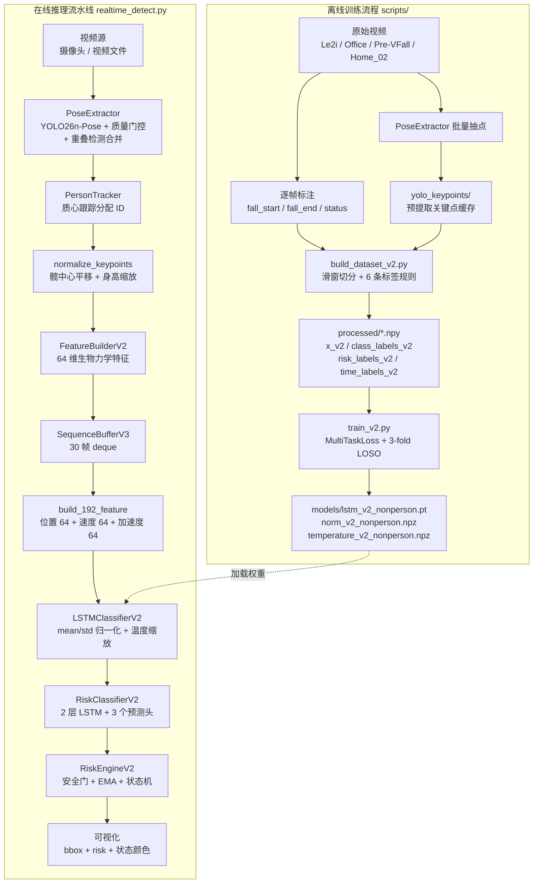
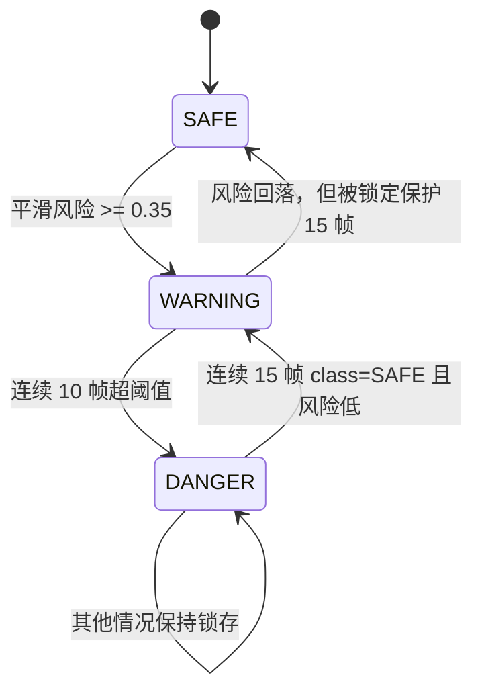
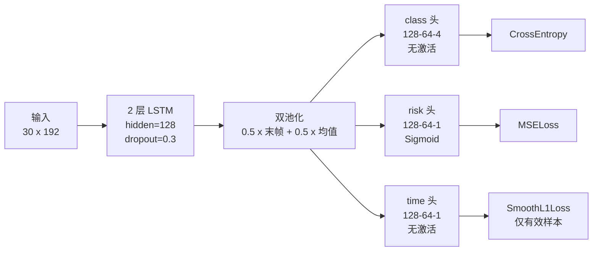

# 系统架构与学习路径

> 本文档基于对当前代码的实际通读整理，**以代码为准**，与 `README.md` 不一致之处已在第五节列出。

---

## 目录

- [一、项目定位](#一项目定位)
- [二、架构图](#二架构图)
- [三、数据契约](#三数据契约)
- [四、模块速查](#四模块速查)
- [五、关键设计决策](#五关键设计决策)
- [六、仓库现状与偏差](#六仓库现状与偏差)
- [七、学习路径](#七学习路径)
- [八、待验证清单](#八待验证清单)
- [九、后续优化方向](#九后续优化方向)

---

## 一、项目定位

**姿态估计 + 时序深度学习**的老年人跌倒检测流水线。

```
摄像头帧 → YOLO26n-Pose 关键点 → 64 维生物力学特征 → 30 帧滑窗
         → 192 维时序张量 → 2 层 LSTM 多任务模型 → 风险状态机 → SAFE/WARNING/DANGER
```

**当前主线是 V2 版本**（4 类分类 + 风险回归 + 时间回归），由 `realtime_detect.py` 驱动。
`README.md` 描述的是 V4/5 类版本，部分内容与代码不符（见第六节）。

### 4 类定义

| 类 ID | 名称 | 含义 |
|---|---|---|
| 0 | SAFE | 正常行走 / 站立 |
| 1 | FALLEN | 已跌倒 / 躺地 |
| 2 | SITTING | 坐下 |
| 3 | NON_PERSON | 家具等非人误检 |

> **没有 WARNING 类**。WARNING 由回归头输出的连续风险值配合状态机表达，见第五节。
> 详细标签规则见 [`docs/classification-logic.md`](classification-logic.md)。

---

## 二、架构图

### 2.1 离线训练 + 在线推理



> `PersonTracker` 为**每帧每个目标分配稳定 ID**，`realtime_detect.py` 以该 ID 索引
> `SequenceBufferV3` 与 `RiskEngineV2`，实现多目标各自独立的时序与状态
> （见 §9.1，2026-10 已接入）。

### 2.2 状态机 `RiskEngineV2`



三个计数器语义：

| 变量 | 作用 |
|---|---|
| `counter` | 连续超阈值帧数，达 `trigger_frames=10` 触发 DANGER |
| `danger_confirmed` | DANGER 锁存标志，防止状态抖动 |
| `lock_count` | 双重职责：DANGER 解锁倒计时 + WARNING 退出的锁定保护 |

### 2.3 多任务网络 `RiskClassifierV2`



#### 头部形状流转（实测）

三个头**并行**消费同一个 `pooled` 向量，不存在 “3×64” 这样的拼接结构。
`64` 是每个头**内部的中间层宽度**（超参），`4 / 1 / 1` 才是各头的**输出**维度。

| 层 / 输出 | 形状 | 说明 |
|---|---|---|
| 输入 | `(1, 30, 192)` | batch × 30 帧 × 192 维 |
| LSTM 输出 | `(1, 30, 128)` | 每个时间步 128 维 |
| 双池化 `pooled` | `(1, 128)` | 非模块输出，由 LSTM 输出计算 |
| class 头中间层 | `(1, 64)` | `Linear(128, 64)` |
| class 头输出 | `(1, 4)` | `Linear(64, 4)`，无激活 → logits |
| risk 头中间层 | `(1, 64)` | `Linear(128, 64)` |
| risk 头输出 | `(1, 1)` → `(1,)` | `Linear(64, 1)` + `Sigmoid`，再 `squeeze(-1)` |
| time 头中间层 | `(1, 64)` | `Linear(128, 64)` |
| time 头输出 | `(1, 1)` → `(1,)` | `Linear(64, 1)`，无激活，再 `squeeze(-1)` |

> 名为 `64` 但含义不同的量共有三处，彼此无关：
> 单帧特征维度（51+6+7）、192 中每个区块的宽度、每个头的中间层宽度。

#### 参数量分布（实测）

| 组件 | 参数量 | 占比 |
|---|---|---|
| `lstm` | 296,960 | 92.08% |
| `class_proj` | 8,384 | 2.60% |
| `risk_proj` | 8,384 | 2.60% |
| `time_proj` | 8,384 | 2.60% |
| `classifier` | 260 | 0.08% |
| `risk_head` | 65 | 0.02% |
| `time_head` | 65 | 0.02% |
| **合计** | **322,502** | 100% |

参数绝大部分在 LSTM 上，三个头合计仅约 8%。想显著改变模型容量应调整
`hidden_dim` / `num_layers`，改头宽度收益很小。

> 以上数据由 `scripts/eval/trace_shapes.py` 实测输出（无需权重文件即可运行）。

---

## 三、数据契约

理解本项目的钥匙 —— 张量形状的流转链路：

| 阶段 | 形状 | 产出位置 |
|---|---|---|
| 视频帧 | `(H, W, 3)` BGR uint8 | `cv2.VideoCapture` |
| YOLO 检测 | `bbox(4,)` + `kpts(17,2)` + `conf(17,)` | `PoseExtractor.extract` |
| 关键点归一化 | `(17,2)` | `features/normalize.py` |
| 单帧特征 | `(64,)` | `FeatureBuilderV2.build` |
| 序列缓冲 | `(30, 64)` | `SequenceBufferV3` |
| 模型输入 | `(30, 192)` | `build_192_feature` |
| 模型输出 | `probs(4)` + `risk∈[0,1]` + `time_to_fall` | `LSTMClassifierV2.predict` |
| 决策输出 | `{risk_score, state, danger_confirmed}` | `RiskEngineV2.update` |

### 3.1 单帧 64 维的生成路径

全部发生在 `realtime_detect.py` 的这两行：

```python
nk, nc = normalize_keypoints(kpts, kpts_conf)   # Step 1 + 2
feature = FeatureBuilderV2.build(nk, nc)        # Step 3
```

**Step 1 — YOLO 输出**

| 变量 | 形状 | 含义 |
|---|---|---|
| `keypoints` | `(17, 2)` | 像素坐标 |
| `kpts_conf` | `(17,)` | 逐关键点置信度 |

COCO 顺序：`0 nose, 1 leye, 2 reye, 3 lear, 4 rear, 5 lsho, 6 rsho, 7 lelb,
8 relb, 9 lwri, 10 rwri, 11 lhip, 12 rhip, 13 lkne, 14 rkne, 15 lank, 16 rank`

**Step 2 — 归一化：平移 + 缩放**

```python
bh = |nose - (lank + rank)/2|          # 体高
if bh < 5.0: 归一化失败
hip_center = (lhip + rhip)/2
kpts_norm = (kpts - hip_center) * (100.0 / bh)
```

把**髀中心移到原点、体高缩放到 100 px**。置信度原样透传，不参与归一化。

**Step 3 — 组装 64 维**

| 区块 | 索引 | 维度 | 内容 |
|---|---|---|---|
| 关键点 | `0..50` | 51 | 第 k 个关键点的 `x, y, conf`，**交错布局**（`3k, 3k+1, 3k+2`） |
| 原始几何 | `51..56` | 6 | `cg_y` / `torso_angle` / `left_knee_angle` / `right_knee_angle` / `foot_distance` / `body_height` |
| 增强几何 | `57..63` | 7 | `cg_y_norm` / `foot_norm` / `com_x` / `com_y` / `left_hip_angle` / `right_hip_angle` / `torso_angle` |

> **注**：`51` 与 `57` 既是几何量（归一化后恒 ≈ 0），也是**检测框 `score` 与其
> 有效性掩码的载荷位** —— 见 §8.1.3。传了 `score` 参数时这两格被覆盖，
> 其余 62 维不变。

几何量的公式：

```python
# 躯干倾角：肩中点相对髀中心的偏移
dx, dy = shoulder_center - hip_center
torso_angle = degrees(arctan2(|dx|, |dy|))       # 0° = 直立, 90° = 平躺

# 关节角：_angle(a, b, c) 即 ∠abc，b 为顶点
left_knee_angle = _angle(lhip, lkne, lank)
left_hip_angle  = _angle(shoulder_center, lhip, lkne)

# 质心：四点平均
com = (lhip + rhip + lsho + rsho) / 4
```

`_angle` 内部为 `arccos(ba · bc / (|ba| |bc|))`，两点重合时返回 0。

**实测样例**（放在画面右下角的站姿骨架，`bh = 160px`、`scale = 0.625`）：

```
[  0.    -37.5     1.      2.5   -40.      0.988  -2.5   -40.      0.975]   <- [0:9]

[51] cg_y               =       0.0000   <- 恒为 0
[52] torso_angle        =       0.0000   <- 站直
[53] left_knee_angle    =     180.0000   <- 站直，膝角 180°
[54] right_knee_angle   =     180.0000
[55] foot_distance      =      12.5000
[56] body_height        =     100.0000   <- 恒为 100
[57] cg_y_norm          =       0.0000
[58] foot_norm          =       0.1250   <- foot_distance / 100
[59] com_x              =       0.0000
[60] com_y              =     -14.0625   <- 质心在髀中心上方
[61] left_hip_angle     =     171.0652
[62] right_hip_angle    =     171.0652
[63] torso_angle        =       0.0000   <- 与 [52] 完全相同
```

### 3.2 使用前必须先标准化

原始 64 维各维**尺度差异极大**：`conf` 在 `0~1`、坐标在 `±100`、角度在 `0~180`。
因此 `LSTMClassifierV2.normalize()` 会先用训练集统计的 `mean/std` 逐维标准化，再送进 LSTM。

> 这也是 `models/norm_v2_nonperson.npz` 不可或缺的原因 —— 缺了它模型无法正确推理。

### 3.3 四个易踩的坑

| # | 位置 | 问题 |
|---|---|---|
| 1 | `FeatureBuilderV2.build` | `confs=None` 时内部用 `np.ones(17)` 兜底，17 个 `conf` 维退化为常量 1.0，等于白占维度 |
| 2 | `normalize_keypoints` | 归一化锁死 `cg_y = 0`、`body_height = 100`，**绝对尺度信息完全丢失**（详见 §8.1） |
| 3 | `torso_angle` | 公式取 `arctan2(|dx|, |dy|)`，输出恒在 `[0°, 90°]` —— **丢失方向**，前倾/后仰、左倾/右倾无法区分 |
| 4 | `realtime_detect.py` | 归一化失败时兜底走 `build(kpts, kpts_conf)`，即用**未归一化的原始像素坐标**建特征，与训练分布不符（见 §6.4） |

### 3.4 192 维的构成

`[位置(64) | 速度(64) | 加速度(64)]`，其中速度/加速度由**一阶/二阶差分**得到：

```
vel[0] = 0,  vel[t] = pos[t] - pos[t-1]
acc[0] = 0,  acc[t] = vel[t] - vel[t-1]  =  pos[t] - 2·pos[t-1] + pos[t-2]
```

三点性质：

1. **不是新采集的数据**。`vel` / `acc` 都是 `pos` 的确定性函数，逐元素差分**不改变形状**，
   所以 `(30,64) → (30,192)` 是同一份数据的三种视角。
   —— **192 = 64 维信息 × 3 种视角，不是 3 倍信息**。其价值在于把"变化"显式化，
   免去线性层自己学差分。
2. **有两处虚假边界值**。`vel[0] = 0` 是硬编码的（无 `t-1` 可减），且会污染 `acc[1]`：
   实测某窗口 `acc[1]` 真实值 `0.6898` 被算成 `0.1437`。详见 §9.1。
3. **26.6% 的维度与置信度相关**（51/192），且其中 34 维价值可疑。
   `pos` 里的 17 个 `conf` 维提供“可信度权重”（合理），
   但 `vel` / `acc` 里各 17 个是**置信度的差分** —— 那是差分“盲操作”的副作用，
   不是设计选择。实测其 SNR 仅 `0.002`（坐标维 `0.593`）。详见 §9.4。

---

## 四、模块速查

| 路径 | 职责 | 关键点 |
|---|---|---|
| `realtime_detect.py` | 推理主循环 | 192 维拼接、跟踪 ID 隔离、目标丢失填充 |
| `pose/pose_extractor.py` | YOLO26n-Pose 封装 | `conf=0.05`、三重质量门、重叠合并 |
| `tracker/person_tracker.py` | 质心跟踪 | 最近质心 + IoU 兜底匹配；未确认轨道超时淘汰 |
| `features/normalize.py` | 关键点归一化 | 髋中心平移 + 身高缩放到 100px |
| `features/feature_builder_v2.py` | 64 维特征 | 51 + 6 + 7 |
| `sequence/sequence_buffer.py` | 30 帧滑窗 | per-person deque，NaN 丢弃 |
| `classifier/risk_classifier_v2.py` | 网络定义 | 双池化、三头、激活差异 |
| `classifier/lstm_classifier_v2.py` | 推理封装 | mean/std、温度缩放、time 还原 |
| `pipeline/risk_engine_v2.py` | 状态机 | 安全门、EMA、三计数器 |
| `scripts/build/build_dataset_v2.py` | 数据构建 | 6 条标签规则、滑窗 STRIDE=3 |
| `scripts/build/extract_keypoints.py` | 关键点缓存生成 | 逐帧 PoseExtractor、多人取 conf 和最大者 |
| `scripts/train/train_v2.py` | 训练 | MultiTaskLoss、3-fold LOSO、温度标定 |
| `scripts/eval/trace_shapes.py` | 形状 / 参数量 / 冗余自查 | 无需权重文件即可运行 |

### 核心常量一览

| 模块 | 常量 | 值 |
|---|---|---|
| `build_dataset_v2.py` | `WINDOW_SIZE` / `STRIDE` | 30 / 3 |
| `build_dataset_v2.py` | `TAU` / `PRE_FALL` / `NORMAL_TIME` | 50 / 120 / 999 |
| `train_v2.py` | `EPOCHS` / `BATCH_SIZE` / `HIDDEN_SIZE` | 50 / 256 / 128 |
| `train_v2.py` | `LAMBDA_RISK` / `LAMBDA_TIME` | 0.30 / 0.10 |
| `RiskEngineV2` | `alpha` / `warning_thres` | 0.4 / 0.35 |
| `RiskEngineV2` | `trigger_frames` / `lock_frames` | 10 / 15 |

---

## 五、关键设计决策

### 5.1 不设 WARNING 类，改用回归头表达连续风险

规避"WARNING 类需要足够多标注数据"的难题，同时得到比离散类更细的风险梯度。
训练标签为指数衰减：`risk = exp(-time_frames / TAU)`，`TAU=50`：

| 距跌倒完成帧数 | 风险值 |
|---|---|
| 0 | 1.000 |
| 10 | 0.819 |
| 30 | 0.549 |
| 50 | 0.368 |
| 120（`PRE_FALL` 边界） | 0.091 |

**风险回归头的三档实际来源**（A/B 实测，见 §8.4）：

| 真实风险档 | 来源 | 样本数 |
|---|---|---|
| 0.0 | Le2i 正常 / Pre-VFall Normal | 15,924 |
| 0.5 | **仅** Pre-VFall Abnormal（异常步态未跌倒） | 1,806 |
| 1.0 | Le2i 跌倒 / Pre-VFall Fall | 3,184 |
| 0–1 连续 | Le2i 跌倒前指数衰减（依据上表） | 3,392 |

即**预警档 0.5 完全依赖 Pre-VFall 的 Abnormal 片段**；仅用 Le2i 时该档样本数为 0。

### 5.2 双池化

```python
pooled = 0.5 * out[:, -1, :] + 0.5 * out.mean(dim=1)
```

兼顾"末帧即时状态"与"整窗平均趋势"，对滑窗相位不敏感。

### 5.3 两道安全门（`_compute_danger_prob`）

把分类头的**语义硬约束**灌进回归头，防止回归值在语义矛盾时误导状态机：

| 分类结果 | 处理 |
|---|---|
| `SITTING` / `NON_PERSON` | 风险强制归零 |
| `FALLEN` | 风险抬到 ≥ 0.7 |
| `SAFE` | 直接采用回归值，裁剪到 `[0,1]` |

### 5.4 `conf=0.05` 的低阈值 + 质量门控

人跌倒后 YOLO-Pose 检测置信度大幅下降（检测率 5% → 55%），故把 `conf` 从 0.25 降到 0.05；
但低阈值会引入家具误检，用 `_is_valid_person` 的三重门补回来：

- 有效关键点（`conf>0.3`）数量 ≥ 4
- 有效关键点空间跨度 ≥ 8px
- 平均关键点置信度 ≥ 0.3
- 附加条件：`bbox score < 0.15` **且** 跨度 < 35px → 判为物品

### 5.5 重叠检测合并使用 IoU + containment 双条件

跌倒后 YOLO 常把一个人检测成多个框（头一个 + 身体一个）。
单靠 IoU 无效（小框在大框内时 IoU 可能 < 0.3），故补充
`containment = intersection / min(areaA, areaB)`，阈值 0.6。

### 5.6 温度缩放只作用于分类头

`RiskClassifierV2` 分类头输出除以温度 `T` 后再 softmax，用于校准置信度；
风险头是 Sigmoid 回归，不做温度缩放。

---

## 六、仓库现状与偏差

### 6.1 缺失的运行时产物

仓库为**纯代码**，缺失全部权重与训练数据：

| 缺失项 | 影响 |
|---|---|
| `models/` 整个目录 | 无 `yolo26n-pose.pt`、`lstm_v2_nonperson.pt`、`norm_v2_nonperson.npz`、`temperature_v2_nonperson.npz` |
| `yolo_keypoints/` 目录 | 无预提取关键点缓存，需用 `scripts/build/extract_keypoints.py` 重新抽点 |
| `processed/*.npy` | 仅有 3 个 json meta，无 `x_v2.npy` 等训练数据 |
| Le2i 原始视频与标注 | 不含于仓库，需从 [Kaggle: falldataset-imvia](https://www.kaggle.com/datasets/tuyenldvn/falldataset-imvia) 获取（190 个 `.avi` + 130 份标注，约 16 GB），并按 `build_dataset_v2.py` 的 `ARCHIVE` 结构摆放 |
| Pre-VFall 原始数据 | 不含于仓库，需从 [Figshare v3（Pre-VFall.zip）](https://figshare.com/articles/dataset/Pre-VFall_Vision_Sensor_Simulated_Early_Signs_of_Fall_Dataset/26488216/3?file=48148606) 获取（约 19.6 GB，CC BY 4.0，MD5 `45dc0cc5134ea3a9120b81271dd6ae5e`）；解压后已含逐帧 OpenPose JSON，用 `build_prevfall_dataset.py` 转换即可（6 场景 / 108 受试者 / 287 段目录 / 22,559 个 JSON → 4888 个窗口） |

**结论：clone 后无法直接推理**，必须先重建数据集并训练，或从别处获取权重。

依赖清单已补入仓库根目录的 `requirements.txt`（原本连依赖声明都没有）。

### 6.2 硬编码路径

`scripts/build/build_dataset_v2.py` 中：

```python
ARCHIVE = r"C:\Users\y'y'x\Downloads\archive"
```

Windows 绝对路径，在 macOS/Linux 上需修改后方可重建数据集。

`scripts/build/build_prevfall_dataset.py` 中（Pre-VFall 数据根目录，默认值同样硬编码 Windows 路径，但**已支持 `--data-dir` 覆盖**）：

```python
PREVFALL_DIR = r"/Volumes/media-backup/AI-data/dataset/falldown/Pre-VFall"   # 可用 --data-dir 覆盖
```

此外 `extract_keypoints.py` 的 `ARCHIVE` 与 `KEYPOINTS_DIR` 也已硬编码为绝对路径。

### 6.3 代码与文档的偏差

| 项 | README 描述 | 代码实际 |
|---|---|---|
| 版本 | V4 / 5 类 | V2 / 4 类 |
| 跟踪 | 完整 `PersonTracker` 链路 | ~~**未接入**，`person_id` 硬编码 0~~ **已接入**（2026-10，详见 §9.1） |
| 权重 | `models/` 23 个文件 | 目录不存在 |
| 目录 | 含 `configs/`、`PROJECT_DOC.md` 等 | 不存在 |

### 6.4 其他已知问题

| 位置 | 问题 |
|---|---|
| `sequence_buffer.py` | 默认 `feat_dim=34` 与实际 64 不符（仅文档用途，`update` 不校验维度） |
| `sequence_buffer.py` | `get_velocity/get_acceleration` 与 `realtime_detect.build_192_feature` 逻辑重复 |
| `build_dataset_v2.py` | `subsample_to_10fps` 内部 `step=1`，实为空操作，函数名误导 |
| `train_v2.py` | `scaler` 定义在 `main()` 内，`train_fold` 通过全局引用（可运行但不健壮） |
| `realtime_detect.py` | ~~多目标场景下所有人共用一个 `person_id=0`，缓冲区互相污染（详见 §9.1）~~ **已修复**：按 `PersonTracker` 的 ID 分别维护 buffer 与风险引擎 |
| `realtime_detect.py` | 归一化失败（`bh < 5`）时兜底用**未归一化的原始像素坐标**建特征，属分布外输入 |
| `feature_builder_v2.py` | `_angle_from_vertical` 已定义但全仓库无任何调用（死代码） |
| `feature_builder_v2.py` | `torso_angle` 取绝对值导致倾斜**方向信息丢失**（前倾/后仰不可区分） |
| `build_prevfall_dataset.py` | ~~统计打印 `risk=0.4` 与实际常量 `RISK_ABNORMAL=0.5` 不符，且漏印 `risk=1.0`~~ **已修复**：改为按常量打印三档并附跳过明细 |
| `build_prevfall_dataset.py` | ~~`PREVFALL_DIR` 硬编码 Windows 路径，无 CLI 参数；数据缺失时直接 `sys.exit(1)`~~ **已修复**：新增 `--data-dir`，并在校验段落目录时兼容下划线/连字符两种命名、跳过前缀不符的错位目录 |
| Pre-VFall 数据 | 42 个段落不足 `WINDOW_SIZE=30` 帧（多为 Fall 段，22–29 帧）而被跳过；`confusion_*` 两场景无 Fall 段，共 36 个受试者缺该类别 |

### 6.5 已验证的运行环境

仓库内 `.conda/` 是工作区本地环境（Python 3.14.7）。按 `requirements.txt` 安装后
**实测通过**的版本组合：

| 包 | 版本 |
|---|---|
| numpy | 2.5.3 |
| torch | 2.14.0 |
| torchvision | 0.29.0 |
| opencv-python | 5.0.0.93 |
| ultralytics | 8.4.163 |
| scikit-learn | 1.9.1 |
| scipy | 1.18.1 |
| matplotlib | 3.11.2 |

冒烟测试覆盖范围：

- 项目模块在 numpy 2.x 下正常导入（无 `np.float_` / `np.NaN` 等已移除别名的用法）
- `torch.load(state_dict)` 在 torch 默认 `weights_only=True` 下可用 —— 对应
  `LSTMClassifierV2.__init__` 的加载路径
- `torch.cuda.amp.autocast` 与 `torch.cuda.amp.GradScaler` **仍存在** ——
  `train_v2.py` 依赖这两个已弃用 API，暂不受影响
- `cv2` 的 `VideoCapture` / `rectangle` / `putText` / `FONT_HERSHEY_SIMPLEX` 等调用正常
- 全链路前向：骨架 → 64 维特征 → 30 帧序列 → `(30,192)` → 模型 → `(1,4)/(1,)/(1,)`

> ⚠️ 这套版本显著新于项目开发时所用（numpy 1.24 / opencv 4.x / Python 3.10）。
> 当前实测兼容，但 `numpy 2.x` 与 `opencv 5.0` 都是大版本跃迁。若后续出现难以定位的
> 行为差异，可回退到 `requirements.txt` 注释中记录的 3.10 组合。

> ℹ️ `.vscode/settings.json`（受 git 跟踪）中 `python-envs.defaultEnvManager` 被设为
> `conda`，Python Environments 扩展会据此在仓库根创建/使用 `.conda`。
> 换用其他解释器时需留意这一点。

---

## 七、学习路径

按**执行顺序**阅读，不要按目录顺序。每阶段都有可验证的产出。

### 阶段 0 · 环境跑通（0.5 天）

目标：让画面出现 bbox 和状态文字。

1. 补依赖：`ultralytics`、`torch`、`opencv-python`、`numpy`、`scikit-learn`、`scipy`
2. 获取 `models/yolo26n-pose.pt`（Ultralytics 官方可下载）
3. 跑 `python realtime_detect.py <video>`

**验收**：画面出现 `ID:0 SAFE risk:0.0xx` 叠加层

> 若只有 YOLO 权重而无 LSTM 权重，需先走阶段 5 重建数据集并训练。

### 阶段 1 · 姿态层 `pose/pose_extractor.py`（1 天）

- 通读全文，重点理解 `_is_valid_person` 的阈值取舍与 `_merge_overlapping_detections` 的双条件
- 练习：单张图跑 `extract`，打印每个候选的 `n_valid / spread / mean_conf`，观察过滤边界

**验收**：能解释"为什么 `conf=0.05` 反而比 0.25 好"

### 阶段 2 · 特征工程 `features/`（1–2 天）

- 读 `normalize.py` → `feature_builder_v2.py`，画出 51+6+7 的构成表
- **关键洞察**：因为**先归一化再建特征**，`hip_center` 被平移到原点、身高被缩放到 100，
  导致部分维度退化为常量或完全重复（实测结论见 §8.1）
- 跑 `python scripts/eval/trace_shapes.py` 亲手看一遍 64 维的方差与相关矩阵

**验收**：能说出至少 3 个冗余维度及其成因

**这是全项目性价比最高的改造层**：删冗余维（64 → 57）重训，看是否无损。

### 阶段 3 · 时序建模 `classifier/`（2–3 天）

- `risk_classifier_v2.py`：三个头的激活差异（分类无激活 / 风险 Sigmoid / 时间无激活）+ 双池化
- `lstm_classifier_v2.py`：训练集 mean/std 归一化、温度缩放只作用于分类头、`time` 输出乘 `PRE_FALL` 还原
- 练习：手造假 batch 过 `forward` 验证形状；把温度 1.0 → 2.0 观察 softmax 变化

**验收**：能解释三种损失函数各自的适配理由，以及 time 损失为何只在 `risk>0 & time<1.0` 样本上计算

### 阶段 4 · 决策层 `pipeline/risk_engine_v2.py`（1–2 天）

- 三个计数器的语义区分（见 2.2 节）
- 练习：写独立脚本直接喂人造 `(class_id, risk)` 序列给 `RiskEngineV2`，
  观察 SAFE → WARNING → DANGER → WARNING 的完整时序

**这一层不用重训模型就能做 A/B 实验**，是调参首选。

### 阶段 5 · 训练闭环 `scripts/`（3–5 天）

- `build_dataset_v2.py`：6 条标签规则的**优先级**（已倒地 → 标注倒地 → 末尾坐姿 → 全局坐姿 → 跌倒前预警 → 兜底）
- `train_v2.py`：`MultiTaskLoss` 权重权衡；3-fold LOSO（Leave-One-Scene-Out）为何比随机划分可信
- 前置：修改 `ARCHIVE` 硬编码路径；确保 Le2i 数据集（[Kaggle: falldataset-imvia](https://www.kaggle.com/datasets/tuyenldvn/falldataset-imvia)）与 `yolo_keypoints/` 缓存就位
- 练习：跑通训练，看 confusion matrix，调 `class_weights` 观察 FALLEN 召回敏感度

**验收**：能从 `x_v2.npy` 一路追到 `temperature_v2_nonperson.npz` 的生成过程

### 阶段 6 · 系统集成改造（持续）

按性价比排序：

1. ~~**接入 `PersonTracker`**（首选）—— 消除 `person_id` 硬编码，形成"检测 → 跟踪 → 特征 → 时序"完整多目标链路~~
   ✅ **已完成**（2026-10，详见 §9.1；剩余项：质心匹配在跌倒瞬间易断，见 §9.1「陷阱 B」）
2. 消除 `build_192_feature` 与 `SequenceBufferV3` 的重复实现
3. 修正 `feat_dim` 默认值
4. 抽出 `configs/` 集中管理超参
5. 更新 `README.md` 使其与 V2 代码对齐

---

## 八、待验证清单

以下条目按优先级排列。§8.1 已由脚本实测确认，其余仍为静态阅读的推断。

### 8.1 特征冗余（✅ 已实测确认）

由 `scripts/eval/trace_shapes.py` 用 800 组合成骨架（含随机尺度、平移、扰动与仿真置信度）
实测 64 维的方差与相关矩阵，确认 **7 个维度可剔除 → 有效维度约 57**。

> ⚠️ **但不要直接删。** 有代码**按下标**读这些维度（`is_sitting_posture_v2()` 读 `feat[52..54]`/`[61..62]`，
> 用于生成 `SITTING` 标签），删维会让它**静默读错**。另注意本节的编号基于**合成骨架**，
> 真实数据复测见 §8.1.1，命名与下标依赖见 §8.1.2。

**常量维度（3 个）**

| 索引 | 维度 | 实测 | 成因 |
|---|---|---|---|
| 51 | `geo.cg_y` | 均值 ≈ 0，std 7e-6 | `cg_y = hip_center[1]`，而 `hip_center` 已被归一化平移到原点 |
| 56 | `geo.body_height` | 均值 = 100，std 1e-5 | 归一化用的 `bh` 与 `body_height` 计算公式完全相同 |
| 57 | `geo2.cg_y_norm` | 均值 ≈ 0 | 即 `cg_y / 100` |

**完全相关维度对（4 对，每对可剔除 1 维）**

| 索引对 | 维度 | r | 成因 |
|---|---|---|---|
| 33 ↔ 36 | `kpt.lhip.x` ↔ `kpt.rhip.x` | -1.0 | 归一化后髋部关于原点对称，`rhip = -lhip` **恒成立** |
| 34 ↔ 37 | `kpt.lhip.y` ↔ `kpt.rhip.y` | -1.0 | 同上 |
| 52 ↔ 63 | `geo.torso_angle` ↔ `geo2.torso_angle` | +1.0 | 同一表达式被计算了两次 |
| 55 ↔ 58 | `geo.foot_distance` ↔ `geo2.foot_norm` | +1.0 | 仅差常数因子 100 |

其中 (33↔36) 与 (34↔37) 是**静态阅读时未预料到的**：`normalize_keypoints` 以
`hip_center = (lhip + rhip) / 2` 为原点，故归一化后必然有 `rhip = -lhip`，与输入无关。

**副产物：绝对尺度信息完全丢失**

由于 `cg_y` 与 `body_height` 被归一化锁定为常量，64 维中不含任何绝对尺度信息：

- 远景的人与近景的人无法区分 —— 尺度不变性，通常有利于泛化
- 无法利用「髋部离地面多高」这一直接的跌倒线索 —— 不利，但该量本身受摄像头高度与
  安装角度影响，直接使用会损害跨场景泛化

**复核方式**：`python scripts/eval/trace_shapes.py --samples 2000`

> ⚠️ 该脚本必须给关键点传入**变化的**置信度。若一律传 1.0，17 个 `.conf` 维度会退化为
> 常量，在冗余统计中产生假阳性 —— 这是造数据的假象，不是特征本身的性质。

> 💡 **删常量维还有一个附带好处**：这些维度在训练集上近乎恒定，
> 会让 `LSTMClassifierV2.normalize` 的 `std + 1e-8` 防护变得脆弱（详见 §9.5）。
> 从根上删掉它们，也就同时消除了这个隐患。

#### 8.1.1 真实训练数据复测（2026-10-16 补充）

上面的结论来自**合成骨架**（`trace_shapes.py`）。这次直接在**真实训练数据**上复核
（`processed/x_v2.npy` 抽样 6000 个窗口 = 18 万帧），结论一致，并补两条新发现。

**复核方法**：

```python
x = np.load("processed/x_v2.npy", mmap_mode="r")
d = np.asarray(x[np.linspace(0, x.shape[0]-1, 6000).astype(int)])   # (6000, 30, 192)
pos = d[:, :, :64]                    # 必须先切出 64 维再 reshape，直接 reshape 会错位
flat = pos.reshape(-1, 64)            # (180000, 64)
good = np.abs(flat[:, 56] - 100.0) < 1.0     # 判据必须用 body_height，不能用 cg_y！
```

> ⚠️ **筛"归一化成功"必须用 `body_height ≈ 100`**。不能用 `cg_y == 0`：
> 全零关键点帧同样归一化失败，但它的 `cg_y` 也是 0，会被误判成成功，
> 从而把"`body_height = 0`"这类离群帧混进正常样本里，算出错误的统计量。

**结论复核**（只统计归一化成功的帧，占 **99.9472%**）：

| 索引 | 维度 | 成功帧上的表现 | 与 §8.1 结论 |
|---|---|---|---|
| 51 | `geo.cg_y` | 归一化后 z 恒为 **−0.0171** | ✅ 常量 |
| 56 | `geo.body_height` | 归一化后 z 恒为 **+0.0364** | ✅ 常量 |
| 57 | `geo2.cg_y_norm` | 归一化后 z 恒为 **−0.0166** | ✅ 常量 |
| 52 ↔ 63 | `torso_angle` 两份 | r=**+1.0000**，比值 1.000000 | ✅ 完全重复 |
| 55 ↔ 58 | `foot_dist` / `foot_norm` | r=**+1.0000**，比值 **0.010000** | ✅ 仅差常数 100 |

另一对（在 51 维关键点段内）也复核成立：归一化后 `lhip + rhip` 的 max\|和\| = **2.75e-04**，
即 §8.1 所说的 `rhip = -lhip` 恒等式在真实数据上成立（33↔36 与 34↔37 各可剔除 1 维）。

**新发现：这 3 个"常量维"在真实数据上并非常量，而是被回退路径污染**

`build_dataset_v2.build_window_features()` 有一条回退：

```python
nk, nc = normalize_keypoints(k, c)
if nk is None:            # 身高 < 5px：该帧没有有效检测
    nk, nc = k, c         # ← 回退到【原始像素】关键点
```

回退帧实测 **0.0528%**（95/180000），涉及 **0.63%** 的窗口，且分两种、污染方式不同：

| 类型 | 帧数 | `cg_y` | `body_height` | 后果 |
|---|---|---|---|---|
| 全零关键点帧 | 70 | 0（**看起来像正常**） | **0** | `body_height` 维出现 −47.5 的离群 |
| 真·原始像素帧 | 25 | 原始像素值（≠0） | 原始像素值 | `cg_y` / `cg_y_norm` 维出现 +74 的离群 |

| 项 | 实测 |
|---|---|
| 训练用 `std`（`norm_v2_nonperson.npz`） | `[51]`=**14.068**、`[56]`=2.103、`[57]`=**14.024**（而非 §9.5 原先所写的 ~1e-6） |
| 成功帧上的 \|z\| | ≈ **0.02**（这三个维本来就该是常量） |
| 回退帧上的 \|z\| 最大 | pos：**73.7** / 47.5 / **73.9** |
| 回退帧**相邻帧**（被 vel/acc 波及） | `vel` 最大 **66.5**、`acc` 最大 **79.3** |
| 对照 | 全部 192 维 \|z\| 的 p99.9 = **8.00** |

即：这 **9 个位置**（3 个常量维 × pos/vel/acc 三种视角）实际承载的是
"**该帧没有有效检测**"这一信息，但**幅度失控**（是 p99.9 的 9 倍），
且是**两个量纲混进同一维**。这是**未经设计**的副作用 —— 它现在不一定是坏的
（可能确实为模型提供了有用的"丢帧"线索），但它靠的是意外。

**建议**：修回退路径 —— 用「上一有效帧的值 + `conf` 置 0」替代原始像素关键点，
不要把两个量纲混进同一个维度。

**推论：这 7 个废维可以直接复用，`192` 不必改**

若要给分类头补入新的判别信号（例如检测框 `score`，见 `docs/tuning-log.md` 2026-10-15 条目），
**直接占用这 7 个常量/重复维即可**，无需把 `INPUT_DIM` 从 192 改成 194，
省掉改 `norm` 形状、`RiskClassifierV2` 输入维、以及全仓文档里"192"这一串契约改动。
代价只剩"重建数据集 + 重训"—— 这一项本来就要付（因为特征**内容**变了）。

> ⚠️ **已按此实施并实测否定**（2026-10-16）：`score` 与其有效性掩码占用 `51` / `57`
> 及其 `vel`/`acc` 对应位，`INPUT_DIM` 保持 192。但受控消融显示它会把 held-out 非人
> 判定率拉低 7.3 个点，故 `train_v2.py` 默认**关闭**该通道。详见 §8.1.3。

#### 8.1.2 命名误导与索引依赖（2026-10-16 补充）

**① 「原始几何」不是「原始像素」—— 归一化发生在上一层**

代码里的块名（`# === 原始几何 (6 维) ===` / `# === 增强几何 (7 维) ===`）
容易让人以为前者算在原始像素上、只有后者归一化。**实际不是。**

| 调用点 | 代码 |
|---|---|
| `build_dataset_v2.py:236` | `nk, nc = normalize_keypoints(k, c)` → `FeatureBuilderV2.build(nk, nc)` |
| `build_prevfall_dataset.py:96` | 同上 |
| `build_dataset_5class.py:242` | 同上 |
| `realtime_detect.py:190` | 同上（推理侧；同样带 `if nk is None` 回退，见 §8.1.1） |

`FeatureBuilderV2.build` **自己不调用** `normalize_keypoints`（本文件未 import 它）。
所以它的形参 `kpts` 虽名为"COCO 关键点 x,y"，**实际内容已是"髋中心为原点 + 身高缩放到 100"的坐标**。

受控输入实测（一个正常人形骨架走 `normalize_keypoints → build`）：

| 维度 | 实测 | 若真拿到原始像素，应为 |
|---|---|---|
| `[51] geo.cg_y` | **0.0000** | 髋中心的像素 y（数百） |
| `[56] geo.body_height` | **100.0000** | 像素身高（数百） |
| `[55] geo.foot_dist` → `[58] geo2.foot_norm` | 13.3333 → 0.1333（比值恰 **1/100**） | 两个量纲不同的量 |

**结论：13 个几何维全部算在归一化坐标系里。**「原始 / 增强」之分只是作者当时的认知，不是数据的性质。

**② 为什么「增强几何」那一组是多余的**

角度类特征（`torso_angle` / 膝角 / 髋角）**本身就是尺度与平移不变的**
（`_angle(a,b,c)` 与 `_angle_from_vertical` 只依赖向量方向），归一化对它们没有任何影响。
所以 `[52]` 与 `[63]` 是**同一个表达式算了两遍**，逐位相同（r=+1.0000，比值 1.000000）。

真正会被归一化改变的只有位置/长度类：`cg_y`、`foot_distance`、`body_height`、`com_x`、`com_y`。

**设计意图大概是**"绝对尺度与相对尺度都给模型，让它自己选"，
但**绝对尺度信息在 `normalize_keypoints` 那一步就被丢掉了**（它发生在 `build` 之前），
于是"绝对"那组拿到手的仍是归一化量 → 退化成常量 / 常数倍。
这正是 §8.1「64 维中不含任何绝对尺度信息」的成因。

**③ ⚠️ 删维前必须处理索引依赖，否则会静默读错**

`build_dataset_v2.py` 的 `is_sitting_posture_v2()` 是**按固定下标读回**这些维度的：

```python
torso_angle      = feat[52]
left_knee_angle  = feat[53]
right_knee_angle = feat[54]
left_hip_angle   = feat[61]
right_hip_angle  = feat[62]
```

而它是 **`SITTING` 类标签的生成依据**。因此 §8.1 / §9.5 建议的"删掉 7 个废维"
**不能直接删**：任何下标位移都会让它读到别的维，**不报错**，
`SITTING` 标签会跟着一起坏掉 —— 而它读的恰好是那几个**真有信息**的角度维。

| 做法 | 对索引依赖的影响 |
|---|---|
| **原地替换**废维内容（如 §8.1.1 用它们承载 `score`） | ✅ **安全**，下标不变 |
| **删除**废维（64 → 57） | ❌ 必须先改这些读取（按名/常量索引，或同步更新 5 个下标） |

**建议动手顺序**：先把这些读取改成按名字取值，再删维；
同时把两个块名从"原始 / 增强"改成不误导的说法（如 `几何组 A（首版 6 维）` / `几何组 B（后补 7 维）`），
否则下一个人还会被绕进去。

#### 8.1.3 废维的实际复用：检测框 score 通道（2026-10-16 实施）

按 §8.1.1 的推论落地，**`INPUT_DIM` 保持 192，一个下标都没动**：

| 下标 | 原语义 | 现语义 | 常量定义 |
|---|---|---|---|
| `51` | `geo.cg_y`（归一化后恒 ≈ 0） | **检测框 `score`** | `FeatureBuilderV2.SCORE_DIM` |
| `57` | `geo2.cg_y_norm`（恒 ≈ 0） | **score 有效标志**（0/1） | `FeatureBuilderV2.HAS_SCORE_DIM` |

**为什么必须带一个掩码维**：PV（Pre-VFall，OpenPose JSON）**根本没有检测框**，
占数据 20%、占风险头 `risk>0` 监督的 23.6%。若只把它的 `score` 填 0 而不加掩码，
模型会把这 20% 真人数据读成"框分极低"而推向 `NON_PERSON`，反噬风险头。
掩码位让模型能区分"这一路的 0 是缺信号"与"框分真的很低"。

**改动落点**（训练与推理必须同时改，否则特征错位）：

| 文件 | 改动 |
|---|---|
| `features/feature_builder_v2.py` | `build(kpts, confs, score=None, has_score=None)`；新增 `SCORE_DIM` / `HAS_SCORE_DIM`；`interpolate_missing_frames` 支持第三个数组（抽出 `_fill_neighbors`，逐位等价） |
| `scripts/build/extract_keypoints.py` | 缓存增加 `*_scores.npy`（`(T,)`，漏检帧写 0，与关键点零填充约定一致） |
| `scripts/build/build_dataset_v2.py` | `build_window_features` / `subsample_to_10fps` 透传 score；`load_scores()` **缺失即报错**（不做静默回退，见下） |
| `scripts/build/build_prevfall_dataset.py` | PV 显式传 `score=0.0, has_score=0.0` |
| `realtime_detect.py` | 传 `track["score"]`，**但以模型的 `uses_score` / `score_dims_pinned` 为开关**（三分支，见下） |
| `scripts/train/train_v2.py` | `--score-channel`（默认 **off**）；写 `uses_score` / `score_dims_pinned` 进 sidecar meta；启动时校验掩码维是 0/1 |
| `classifier/lstm_classifier_v2.py` | 暴露 `self.uses_score` / `self.score_dims_pinned`（缺 meta 的老权重一律 `False`） |

**score 在漏检帧上按 `confs` 同样插值**，而不是留 0：漏检帧的几何量已被
`interpolate_missing_frames` 伪造，若 `score` 在此骤降为 0，会造出一串
"有人却有高分、突然掉到 0"的人造尖峰，模型会去拟合这个采样瑕疵。
真正的"该帧是漏检"由 `confs` 已下压的数值表达。

**⚠️ 为什么 score 通道必须由模型自己的 meta 门控**

老权重是在"这两维恒为 0"的数据上拟合 `norm` 的。推理侧若无条件喂入 `score`，
就是在训练/推理之间制造不一致。实测这**不会**炸成离群值（旧 `norm` 里
`std[51]`=14.068，`score=0.86` 只造成 z≈0.044 的偏移 —— 那个 std 全靠 §8.1.1
那 0.03% 的回退帧撑起来），但一个准常量维被系统性地推离 0 仍是错的。
`uses_score` 门控让**同一个 `realtime_detect.py` 能同时正确服务新旧两代权重**，
A/B 回归也因此在同一套 harness 里自动成立。

**⚠️ 数据集不做"有 / 无 score"两版**

`load_scores()` 在缺少 `*_scores.npy` 时**直接报错**，不静默回退。
因为"一半片段有 score、一半没有"会让 `HAS_SCORE_DIM` 退化成**与场景强相关的伪特征**，
比整份数据集都没有这一路信号更糟。受控对照改用 `train_v2.py --score-channel`
（默认**关闭**：在同一份数据上把 6 维置零并钉住 `norm`），从而**两臂的数据完全相同，
只差 score 通道**。

**⚠️ 实测结论：不采纳（2026-10-16）**

受控消融（同一份数据，2 臂 × 2 种子）结果：

| 指标 | 对照（无 score） | 处理（有 score） |
|---|---|---|
| 正常 Le2i 7 段 | 全 0 ✅ | 全 0 ✅ |
| 跌倒 5 段 首DANGER 均值 | 181.4 / 179.8 | 180.2 / 186.6 |
| 真实 6 段 首DANGER 均值 | 154.0 / 145.8 | **117.3 / 123.8** |
| **held-out 非人判定率** | **67.9% / 65.6%** | **60.2% / 58.7%** |

核心指标稳定劣化 7.3 个点（两臂无重叠）。在 score 模型内部把该通道归零，判定率从
60.2%→41.1%、58.7%→47.4% —— 通道**确实被用了**，但启用它反而挤占了其余通路。

因此 `train_v2.py` 的默认是**关闭**（`--score-channel` 默认 off）。`51/57` 这两维
在默认路径下被置零并由 `norm` 钉住（`mean=0 / std=1`），语义回到"不携带信息"。
完整记录与三个实现陷阱见 [tuning-log.md](tuning-log.md) 2026-10-16 条目。

### 8.2 训练数据增强的维度对齐（中优先级）

`train_v2.py` 的 `_augment` 中两处增强使用了**不同的布局假设**：

- 噪声增强：`x[:, :34] += randn * 0.015`，按"先全部 x 再全部 y"的平面布局理解
- 遮挡增强：`x[fstart:fstart+nf, off + kidx*3 : off + kidx*3 + 2] = 0`，按 `(x,y,conf)` 交错布局理解

而 `FeatureBuilderV2.build` 实际产出的是**交错布局**（`x0,y0,c0,x1,y1,c1,...`）。
故噪声增强实际只覆盖了前 11 个关键点。

**验证方法**：打印 `np.flatnonzero(x.std(dim=0) > 0)` 确认噪声影响范围，或按交错布局改为 `x[:, :51]`。

### 8.3 其余可验证项

- `subsample_to_10fps` 在 `step=1` 下不改变帧率，"10fps" 命名与 `TARGET_FPS=25` 常量均具误导性
- 推理滑窗为 stride=1（每帧更新），训练滑窗为 `STRIDE=3`，存在轻微分布差异
- `RiskEngineV2` 的 `lock_count` 在 `elif smooth >= warning_thres` 分支被重置为 `lock_frames`，
  导致 WARNING 状态在风险回落后仍被强制保持 15 帧 —— 需确认这是预期行为

### 8.4 风险回归头的 0.5 预警档是否真的学到（✅ 已实测确认）

**背景**：`0.5` 档仅由 Pre-VFall 的 Abnormal 片段提供（见 §5.1）。在接入 Pre-VFall 之前，
全数据集该档样本数为 **0**，风险回归头实际只在 0.0 / 1.0 两个端点上训练，预警能力无从学起。

**方法**：同一份代码与超参，仅更换训练集做 A/B：

| | A 组（Le2i + Pre-VFall） | B 组（仅 Le2i） |
|---|---|---|
| 样本数 | 24,306 | 19,418 |
| 数据中 `risk=0.5` 标注数 | **1,806** | **0** |
| Risk MAE（脚本自报） | 0.0223 | 0.0237 |
| 阈值准确率（t=0.35） | 98.55% | 98.46% |

**按数据来源分档统计预测值**（`scripts/eval/analyze_risk_buckets.py`，A 组）：

| 来源 / 真实标签 | 样本数 | 预测均值 | 预测 std | 判为预警(≥0.35) |
|---|---|---|---|---|
| Pre-VFall Normal (0.0) | 2,908 | 0.0045 | 0.0017 | 0.0% |
| **Pre-VFall Abnormal (0.5)** | **1,806** | **0.5012** | **0.0093** | **99.9%** |
| Pre-VFall Fall (1.0) | 174 | 0.9980 | 0.0006 | 100.0% |
| Le2i risk=0.0 | 13,016 | 0.0157 | 0.0245 | 0.0% |
| Le2i 指数衰减 (0<r<1) | 3,392 | 0.2645 | 0.2482 | 33.0% |
| Le2i risk=1.0 | 3,010 | 0.9971 | 0.0076 | 100.0% |

**结论**：预警能力从"不可学"变为"可学且已学到" —— A 组在 0.5 档的预测均值 0.5012、
标准差仅 0.0093，几乎精准命中目标；B 组因不存在该档标注，只能学到两个端点。
A 组同时未牺牲原有能力（Le2i 的 0.0 与 1.0 档预测依然准确）。

> **统计陷阱**：若按"预测值落在 0.45–0.55"分档，B 组会出现 312 条"0.5 档"样本，
> 但它们是 Le2i 的**指数衰减**标签恰好落在该区间，并非真异常标注。
> 因此分档必须结合**数据来源**（`scene_id == 10`）而非仅看数值。

---

## 九、后续优化方向

记录已识别、但**当前暂不处理**的改进点，按优先级排列。

### 9.1 多目标支持：当前实为单目标处理（优先级：高）✅ 已修复（2026-10）

> **修复摘要**：`realtime_detect.py` 已接入 `PersonTracker`，以 `track["id"]` 索引
> `SequenceBufferV3` 与 `RiskEngineV2`，每人各自拥有独立的 30 帧窗口与状态机；
> `Track` / `PersonTracker` 已透传 `kpts_conf`（陷阱 A 已解决）。
> 丢失目标的"历史框"显示规则见「建议方案」下的《历史框》小节。
> 跟踪匹配已加 IoU 兜底与轨道确认（陷阱 B 已缓解）。
> **仍余**：YOLO 对倒地/夜间场景的漏检，是"丢对象"的主因，见本节末。
>
> **实测效果**（合成长镜头 `person_falldown-1.mp4`，老人正常走过斑马线后于第 118–125 帧跌倒）：
>
> | | 修复前 | 修复后 |
> |---|---|---|
> | 缓冲区相邻条目平均特征差 | 10.12（跨人交替） | 0.85（同一人相邻帧） |
> | 跌倒前误报 DANGER | 20 次（首个第 108 帧） | **1 次（第 117 帧，即跌倒起始）** |
> | 跌倒前误判 FALLEN 类 | 31 帧，首个第 90 帧（人还在走路） | 0 |
> | Le2i 正常视频（7 段） | Office 19–33 / Lecture 15–27 正常，个别段有零星误报 | 全部 0% WARNING/DANGER |
>
> 以下为修复前的分析原文，保留作为问题记录。


#### 现状

`realtime_detect.py:142` 把 `person_id` 硬编码为 `0`：

```python
for person in persons:        # 确实遍历了所有人
    ...
    person_id = 0             # 但 ID 恒为 0
    buffer.update(person_id, feature)
```

画面里 N 个人全部写进同一个 `buffers[0]`，并共用同一个 `RiskEngineV2` 状态。

四层对照 —— **底层本就是按多人设计的，只有驱动层没把真实 ID 传下去**：

| 层 | 是否支持多人 | 证据 |
|---|---|---|
| `SequenceBufferV3` | ✅ | `self.buffers = {}` → `{person_id: deque}` |
| `RiskEngineV2` | ✅ | `smooth_score` / `counter` / `danger_confirmed` / `lock_count` 均为 dict |
| `draw_result` | ✅ | 已渲染 `ID:{person_id}` |
| `PersonTracker` | ✅ | `tracker/person_tracker.py` 已实现，含 `next_id` / `max_missing` |
| **`realtime_detect.py` 主循环** | ❌ | `person_id = 0` |

#### 问题 1：30 帧窗口被按人数平分

`deque` 的 `maxlen = 30` 限制的是**条目数而非帧数**：

| 人数 | 每帧写入条目 | 窗口跨越帧数 | 每人分到的帧 |
|---|---|---|---|
| 1 | 1 | 30 | 30 |
| 2 | 2 | 15 | 15 |
| 3 | 3 | 10 | 10 |

LSTM 是在“30 个连续帧”上训练的，混写后实际时间尺度按人数成比例缩短。

#### 问题 2：不同姿态交替写入 → 幽灵振荡

先要澄清一个**反直觉**的点：归一化会把位置与尺度差异**完全抹平**，
所以两个人分别站在画面两端**不会**造成伪跳变：

| 对比 | 特征最大差异 |
|---|---|
| 同姿态 @ `(300,400)` vs @ `(900,200)` | `0.000000` |
| 同姿态 1× 身高 vs 2× 身高 | `0.000000` |

真正的污染来自**姿态差异**。以「A 站立 + B 倒地」为例，实测：

| 指标 | 单人站立 | 站立 + 倒地混写 | 放大 |
|---|---|---|---|
| `vel` 平均幅度 | 0.686 | 18.649 | **27.2×** |
| `acc` 平均幅度 | 1.162 | 36.044 | **31.0×** |

`buffer[0]` 内部逐格交替：

```
 格   torso_angle      来源
  0           0.5    A 站立
  1          89.3    B 倒地
  2           0.1    A 站立
  3          89.5    B 倒地
```

`torso_angle` 在 `0°` / `90°` 之间逐格跳变 —— 真人不可能每帧在站立与倒地之间来回切换。
这是喂给 LSTM 的**幽灵振荡**。

顺带一提：正因为归一化抹平了位置与尺度，**姿势相近的两个人特征几乎完全相同**，
使这个错误格外隐蔽 —— 画面上两个框看起来都在正常跟踪。

#### 问题 3：风险引擎计数被按人数放大

`risk_engine.update()` 位于 per-person 循环内，一帧被调用 N 次：

| 场景 | 触发 DANGER 的帧 |
|---|---|
| 单人 | 第 10 帧（`trigger_frames = 10`） |
| 双人 | 第 5 帧 |

EMA 平滑也在同一帧内被反复施加，等效时间常数随之改变。

#### 问题 4：视觉上会骗人

每个框用**自己的 bbox** 绘制，但状态与风险值来自**共享**引擎。后果是双向的：

- 一人跌倒 → 画面里**所有**框都变红显示 `FALL`
- 反之，站立者的特征也在稀释跌倒者的信号（弱化为 `1/N`）

#### 影响范围：只影响推理，不影响训练

| | 窗口来源 | 是否混人 |
|---|---|---|
| 训练 `build_dataset_v2.py` | 按视频加载一份 `(T,17,2)`，滑窗切 `features[start:end]` | ❌ 不混，每窗 30 帧来自同一视频 |
| 推理（现状） | 所有检测结果写进 `buffers[0]` | ✅ 混 |

所以准确的说法是**训练与推理分布不一致**。Le2i 的 `Coffee_room` / `Home_01` / `Home_02`
均为单人场景，训练窗口本身是干净的。

#### 提取脚本

`yolo_keypoints/` 缓存由 **`scripts/build/extract_keypoints.py`** 生成（190 个视频 × 2 = 380 个文件）：
逐帧调用 `PoseExtractor`（含物品误检质量门与分裂检测合并），多人场景取 `kpts_conf.sum()`
最大者，漏检帧写全 0 行。因此“取 score 最高者”确为当年的选人策略。

**验证结果**：按该策略重建缓存后，`Lecture_room` / `Office` / `Coffee_room_01` 相邻帧
髋部中点位移动幅度中位数仅 1–2px、最大 27px，**未出现 A/B 交替的锯齿**，逐帧选人稳定，
训练窗口未因选人跳变而混人。

#### 建议方案 ✅ 已实施（2026-10）

改动集中在主循环：

1. 循环外创建一次 `tracker = PersonTracker(max_missing=MISSING_TOLERANCE)`
2. 每帧 `tracks, removed_ids = tracker.update(persons)`
3. 遍历 `tracks`（而非 `persons`），用 `track["id"]` 调用 `buffer` 与 `risk_engine`
4. 对 `removed_ids` 调用 `buffer.remove(tid)` / `risk_engine.remove(tid)` 并清理
   `last_feature` / `display`，避免 ID 累积导致内存增长
5. 绘制改用 `track["bbox"]`

实际实现与上表的差异：

| 项 | 说明 |
|---|---|
| `max_missing` | 取 `60`（原为 30），对应原 `no_person_frames < 60` 的 "FALL SUSPECTED (target lost)" 容忍窗口 |
| 目标丢失 | 每帧 `track["missing"] > 0` 时用该 ID 的上一帧特征填充 buffer，防止 velocity 通道跳变 |
| 丢失后显示 | 仅在**画面里没有任何已检出目标**时绘制灰色虚线历史框（`draw_lost_result`，标注 `lost Nf` 与 `last seen`）；画面里还有活体目标时只保留顶部报警文字。见下「历史框」 |
| 引擎隔离 | 保留**单个** `RiskEngineV2` 实例（其内部字典本就按 `person_id` 分槽），而非每人一个实例 |

#### 历史框：修复后补充的问题

首次接入后，丢失目标的框仍沿用 `draw_result`（红实线）绘制，且只要 `track["missing"] > 0`
就画 —— 而原代码只在 `len(persons) == 0` 时画。后果：画面里还有别人时，
一个停在旧位置的红色 `FALL` 框会继续显示最长 60 帧，容易被误认为实时检测结果。

`person_falldown-3.mp4`（990 帧，含 3 处合集镜头切换）实测：

| | 画历史框的帧 | 其中画面里还有人 | 连续段长度 |
|---|---|---|---|
| 接入后（未处理） | 181 | **114** | `[60, 60, 60]` |
| 现在 | 67 | **0** | `[7, 1, 59]` |

现规则：画面里还有已检出目标 → 只留顶部 `FALL SUSPECTED (target lost)` 文字；
画面里一个人都没检出 → 画**灰色虚线框**并标注丢失帧数，与实时实线框区分。

> 排查时先怀疑过"复用上一帧特征填充缓冲区"，A/B 实测排除：删掉该行后
> 第 83 帧的历史框一字不差、连续段仍为 `[60, 60, 60]`。
> 但填充确有副作用——它对丢失中的 ID 也会 append 冻结特征，使其缓冲区更早凑满 30 帧
> （同一视频历史框帧数 181→120），而训练侧对漏检帧是零填充后插值，
> 两者口径不同，仍待处理。

#### 接入前必须解决的两个陷阱

**陷阱 A：`PersonTracker` 会丢掉关键点置信度** ✅ 已解决

`Track` 现新增 `kpts_conf` 与 `score` 两个字段，`create_track` / `Track.update` / `to_dict`
全程透传，`PersonTracker.update` 从检测结果里取值。`build()` 不再静默退化为 `np.ones(17)`。

**陷阱 B：质心跟踪在跌倒瞬间最容易断** ✅ 已缓解（IoU 兜底匹配）

原匹配为**贪心最近质心**，阈值 `distance_threshold = 100` px，无 IoU 校验、无运动预测：

```python
dist = self.distance(person["bbox"], track.bbox)
if best_distance < self.distance_threshold:
    best_track.update(...)
else:
    new_track = self.create_track(person)    # 直接新建 ID
```

人跌倒时 bbox 由“竖长”突变为“横宽”，质心大幅下移，很容易超过 100px → 匹配失败 → 新建 ID：

- 新 ID 的 buffer 为空，需再攒 30 帧（25fps 下约 **1.2 秒**）才能推理
- 而跌倒恰恰发生在这段盲区内
- 旧 ID 停止更新，`max_missing` 帧后被移除

**实测**：在 `person_falldown-3.mp4`（990 帧）上，全片 39 次新建 ID 中有 **8 次**新框与某个已丢失
轨道 **IoU ≥ 0.3**，而这 8 次中心距离**全部 >100px**（100.1 / 102.2 / 100.6 / 121.3 / 155.7 /
301.6 / 131.2 / 127.5）。其中 4 次是**真人被正常检测到**（score 0.51–0.91、kpts_conf 和 9.8–14.2）：

| 帧 | 老ID→新ID | IoU | 中心距 | score |
|---|---|---|---|---|
| 126 | 8→9 | 0.57 | **100.1px** | 0.76 |
| 245 | 5→13 | 0.66 | **102.2px** | 0.79 |
| 265 | 13→16 | 0.44 | **121.3px** | 0.51 |
| 329 | 16→19 | 0.36 | **301.6px** | 0.91 |

前两次只超了 0.1px 和 2.2px。**修复**：新增 `iou_threshold=0.3` 兜底匹配 ——
主匹配（质心 < 阈值）失败后，若某轨道与检测框 IoU ≥ 0.3 则仍判为同一目标。
实测新建 ID 次数 **39 → 31**（正好消掉这 8 次）。

> 顺带纠正一个直觉：同一轨道自身的帧间中心位移**中位数仅 9.1px、最大 94.6px**，
> 从未越过 100px 阈值。越过阈值的不是"人移得快"，而是"框在变形"（跌倒时下沿下探）
> 或"框本身是低置信大区域"。

#### 僵尸轨道：单帧垃圾检测

`person_falldown-3.mp4` 上 39 个轨道里有 **11 个（28%）只被匹配过 1 次** ——
由单帧垃圾检测创建，随后带着 `missing` 一直挂 61 帧才被移除。它们不画框，
但那个**过期 bbox 会留在匹配池里**，一旦后续检测的中心落进 100px 就会被抢占。

尝试过给 `_is_valid_person` 加 bbox 合理性门（面积占比 / 最小边），**数据上无法设阈值**：

| 判据 | 真人轨道（检出≥5次，n=23） | 单帧垃圾轨道（n=11） |
|---|---|---|
| 框最小边 | 161 – 488（中位 293） | 84 – 577（中位 281） |
| 占画面面积比 | 1.9% – 22.3% | 2.1% – 13.0% |
| 检测 score | ≥ 0.51 | ≤ 0.21 |

最小边与面积占比都严重重叠（f824 垃圾框占 22.0%/score 0.203，而 f245 **真人**框占 22.3%/score 0.79），
唯一干净的判据是检测置信度——但那等于把 `conf` 抬回 0.3，与"降到 0.05 以捕捉倒地姿态"的既有决策冲突。

**改用时间维度**：`Track.is_lost()` 对未确认轨道（`hit_count < min_hits=2`）只给
`max_missing_unconfirmed=15` 帧容忍，超时即移除；已确认轨道仍按 `max_missing` 容忍遮挡。
15 帧取自实测——真人轨道"丢失后又被找回"的间隔：中位数 2、p90 14、最大 51。

实测僵尸轨道寿命 **61 → 16 帧**（10 个全部）。

#### 回归验证

跟踪改动后，Le2i 跌倒视频的**首次 WARNING / 首次 DANGER 帧与改动前逐帧一致**：

| 视频 | 首 WARNING | 首 DANGER |
|---|---|---|
| Office 1 | 289 | 298 |
| Office 5 | 138 | 147 |
| Lecture 1 | 129 | 197 |
| Home_01 1 | 131 | 140 |
| Home_01 10 | 103 | 112 |

（Office 1 与 Home_01 10 的 DANGER *绘制次数* 下降 49 / 52 次，是因为同一个人此前被多条冗余
轨道重复画框，现已被 IoU 兜底合并。正常视频 9 段仍全部 0% WARNING/DANGER。）

#### 仍未解决：检测漏检是"丢对象"的主因

跟踪健壮性改进只覆盖了 24% 的断裂。`person_falldown-3.mp4` 全片 **22.4% 的帧零检出**，
后段有连续 **32 帧**（f797-828）、**23 帧**（f945-967）的整段零检出。f876 画面左下角
确实有人（蹲/爬在电动车旁），但原始 YOLO 在 `conf=0.01` 下最好的候选是
`997×210 / conf 0.025` 的巨型区域，**根本没有人的框**。

这属于下文「YOLO 对仰卧/倒地姿态检测失败」的能力问题，需要更贴合的夜间/倒地训练数据，
不是跟踪层能修的。


#### 顺带发现：另一处训练/推理不一致

| | vel/acc 计算范围 | 窗口第 0 帧的 vel/acc |
|---|---|---|
| 训练 `build_window_features` | 整段序列先算完再切窗口 | **非零**（与窗口外前一帧差分） |
| 推理 `build_192_feature` | 仅在窗口内计算 | `vel[0] = 0`、`acc[0] = 0` |

`vel[0]` 被硬编码为 0 后会**污染下一帧**：`acc[1] = vel[1] - vel[0]`，
使 `acc[1]` 也变成假值。实测（`start=10` 的窗口）：

| 区块 | 不一致时间步 | 不一致值数 |
|---|---|---|
| `pos` | 无 | 0 |
| `vel` | `t=0` | 64 |
| `acc` | `t=0`, `t=1` | 128 |
| **合计** | | **192 / 5760 = 3.33%** |

出现频率的差别更关键：

| | 带此缺陷的窗口比例 |
|---|---|
| 训练 | `1 / 31 ≈ 3.2%`（仅 `start=0` 的那个窗口） |
| 推理 | **100%**（每个窗口都在窗口内重算差分） |

即推理时**每一次**都带着这个伪影，而训练时模型几乎见不到它。
量不大，但与"两处拼接逻辑重复实现"（§6.4）同源，统一实现时一并解决。

#### 核心结论

> 模型是在“单个人 30 个连续帧”上训练的 → 推理就必须喂“单个人 30 个连续帧”。

这是训练方式决定的**硬约束**，不是可选优化。归一化本身没有问题
（它提供的位置/尺度不变性是必要设计），问题只在 `person_id = 0` 这一行。

### 9.2 `torso_angle` 的方向信息丢失（优先级：中）

#### 现状

`FeatureBuilderV2.build` 的躯干倾角公式：

```python
dx, dy = shoulder_center - hip_center
torso_angle = degrees(arctan2(|dx|, |dy|))
```

两个分量都取了绝对值，因此输出恒在 `[0°, 90°]` —— 只能表达“倾斜了多少度”，
**不能表达“往哪边倾”**。同时该值在索引 52 与 63 各出现一次（重复，见 §8.1）。

#### 为什么可能是问题

跌倒的**方向**是有判别力的信号：向前扑倒、向后仰倒、侧向倒地的姿态演化差异很大。
当前模型只能看到倾角的幅度，看不到符号。

#### 但关键坑在于：不能简单地“把绝对值去掉”

直觉上的修法是改成 `degrees(arctan2(dx, dy))`，但这样会引入**朝向混淆**：

> YOLO 的 `lsho` / `rsho` 是按**人体解剖学左右**标注的，不是图像左右。
> 当人背对镜头时，`lsho` 会出现在图像右侧，`dx` 的符号整体翻转。
>
> 结果：同一个“向左倒”的动作，人面朝镜头与背对镜头时会给出**相反**的 `torso_angle` 符号。

现在的绝对值写法很可能**本来就是刻意的**，用来消除这种朝向依赖。
所以真正的优化目标不是“恢复方向”，而是“在朝向无关的前提下拿到方向信息”。

#### 候选实现

| 方案 | 做法 | 是否朝向无关 |
|---|---|---|
| A. 竖向符号 | 增加 `dy / bh`（肩中点相对髀中心的归一化竖向偏移） | ✅ 是。头在上 / 头在下与朝向无关 |
| B. 倾斜向量 | 直接给出归一化的 `(dx/bh, dy/bh)` 两维，让模型自己学 | ⚠️ 否，与朝向耦合 |
| C. 交给时序 | 不改单帧特征，靠 `192` 维里的速度/加速度块捕捉躯干角的变化率 | ✅ 是，零改动 |

方案 C 值得先验证 —— `192` 维里的 `vel` / `acc` 已包含躯干角的一阶/二阶差分，
很可能已经隐含了方向信息，建议先做消融再决定要不要加维度。

#### 改动前必须知道的风险

1. **破坏维度契约**：`64 → 65+` 后 `models/norm_v2_nonperson.npz` 的 `mean` / `std` 形状不匹配，
   必须重训模型并重新生成归一化参数
2. **静默错位**：`build_dataset_v2.py` 的 `is_sitting_posture_v2` 直接硬编码读取
   `feat[52] / feat[53] / feat[54] / feat[61] / feat[62]`。任何插维/删维都必须同步修改它，
   否则坐姿检测会静默拿到错误的量，**不会报错但结果全错**
3. **性价比**：当前误报的主因依我看在特征冗余（§8.1）与 SITTING / NON_PERSON 混淆，
   方向信息属于锦上添花，建议排在它们之后

#### 验证方法

- 先做消融：对真实视频统计跌倒前后 `torso_angle` 的分布，看“站→倒”的变化是否已足够可分
- 再用方案 C 对比：把 `vel` / `acc` 中的躯干角分量置零，看 FALLEN 召回率下降多少。
  若下降明显，说明方向信息已被隐含利用，无需再加维度

### 9.3 其他候选（已记录在别处）

| 优化点 | 详情 |
|---|---|
| 删冗余特征 7 维（`64 → 57`） | §8.1 |
| 消除 `build_192_feature` 与 `SequenceBufferV3` 的重复实现 | §6.4 / §9.1 |
| 修复 `_augment` 的维度错位 | §8.2 |
| 修复归一化失败时的兜底分支 | §3.3 / §6.4 |
| 修复窗口第 0 帧 vel/acc 与训练不一致 | §9.1 |
| conf 差分置零消融（`192 → 158`） | §9.4 |
| `normalize` 的 `std` 防护加固 | §9.5 |
| 视角/距离不变性：量化代价与距离代理 | §9.6 |
| 步态强度（走/跑）特征与奔跑样本缺口 | §9.7 |
| ~~时序编码器替换（LSTM → TCN）~~ **已实测不采纳** | 离线无差异、端到端更差，见 `docs/tuning-log.md` 2026-10-16 |
| ~~池化方式 `0.5*末帧 + 0.5*均值`~~ **已实测：无替代方案更优，维持现状** | `docs/tuning-log.md` 2026-10-16 |

### 9.4 conf 差分价值低：置零消融方案（优先级：中）

#### 问题：差分是“盲操作”

```python
vel[1:] = raw[1:] - raw[:-1]     # 它不知道哪一维是坐标、哪一维是 conf
```

`raw` 是 64 维整体，差分统一施加。所以 17 个 `conf` 维被差分**不是设计选择，而是副作用** ——
比例达 `51 / 192 = 26.6%`（`pos` 17 + `vel` 17 + `acc` 17）。

#### 为什么价值低：差分对信号与噪声的作用相反

| | 差分前 | 差分后 | 效果 |
|---|---|---|---|
| 平滑运动（坐标维） | std `8.95` | std `≈ 0`（恒速） | **信号被提取成小量** ✅ |
| iid 抖动（conf 维） | std `0.05` | std `0.071` | **噪声被放大 √2 倍** ❌ |

实测噪声放大 `1.4168` 倍（理论 `√2 = 1.4142`）；差分后的信噪比：

| 维度类型 | `vel` 的 SNR |
|---|---|
| 坐标维 | `0.593` |
| conf 维 | **`0.002`** |

`conf` 反映的是“YOLO 有多确信这个点可见”，没有“运动”可言。以一次真实遮挡为例
（`t=12` 进入遮挡、`t=17` 恢复）：

- 差分绝对值最大的时刻恰好是 `t=12` 与 `t=17` —— 遮挡的**开始与结束**
- 其余 `26 / 30 = 87%` 的帧是纯放大的噪声

#### 但也不是零信息，只是冗余

conf 差分的非零时刻确实标记了遮挡切换。但这份信息 `pos` 里的原始 `conf` 已经给了，
LSTM 有能力自己从 `conf` 序列学出“它刚掉下去了”。所以差分版是**冗余且以噪声为主**。

#### 建议的验证方式：置零消融

不删维度，只在差分后把 conf 位置清零：

```python
CONF_IDX = np.array([3 * k + 2 for k in range(17)])   # 2, 5, 8, ..., 50

vel[:, CONF_IDX] = 0
acc[:, CONF_IDX] = 0
```

两处都要改：`realtime_detect.build_192_feature` 与 `build_dataset_v2.build_window_features`。

**为什么用置零而不是删维度**：

| | 置零 | 真删维（`192 → 158`） |
|---|---|---|
| shape 不变 | ✅ 仍为 `192` | ❌ 需重新生成 `norm_v2_nonperson.npz` |
| 影响 `is_sitting_posture_v2` 的硬编码索引 | ✅ 无（`pos` 索引未变） | ❌ 必须同步修改（§9.2） |
| 变量是否单一 | ✅ 只改信息量，容量不变，消融干净 | ❌ 同时改了容量，混淆因素 |
| NaN 风险 | ✅ 训练集上恒为 0 → `mean=0, std=0` → `(0-0)/1e-8 = 0` | — |

只需重训一次，对比 FALLEN 召回率与风险 MAE。**若指标不降，即确认这 34 维可删。**

#### 真删维的收益（供参考）

| 方案 | LSTM 第一层 `weight_ih` 参数量 | 相对现在 |
|---|---|---|
| 现在 `192` | 98,304 | — |
| 去掉 34 个 conf 差分 `158` | 80,896 | **−17.7%** |
| 再叠加 §8.1 的 7 个冗余维 `137` | 70,144 | **−28.6%** |

对全模型（322,502 参数）只省 5~9% —— 真正的收益在**降低过拟合风险**，不是省算力。

### 9.5 `normalize` 的 `std` 防护脆弱性（优先级：低）

#### 现状

```python
self.std = np.load(norm_path)["std"] + 1e-8
out = (x - mean) / std
```

`+1e-8` 是为防除零。但对**恒为常量的维度**（§8.1 列出的那些）防护不足：

| 训练集上的 `std` | 推理时的值 | 标准化后 |
|---|---|---|
| `0.0` | `1e-5` | **1000.0** ← 1000 倍离群输入 |
| `0.0` | `1e-6` | 100.0 |
| `1e-7` | `1e-5` | 90.9 |
| `1e-5` | `1e-5` | 1.0 ← 健康 |

#### 当前实测是安全的（但原因与原先分析不同）

> ⚠️ **数字已更正（2026-10-16）**。本节原先写的 `std ≈ 7.7e-06` 取自**合成骨架**，
> 与真实训练集不符。生产 `norm_v2_nonperson.npz` 里的实际值是
> `[51]`=**14.068**、`[56]`=2.103、`[57]`=**14.024**。
> 之所以不是 ~1e-6，是因为约 0.053% 的帧走了"回退到原始像素"的路径（详见 §8.1.1）。

| 索引 | 训练集 std | 成功帧的 \|z\| | 回退帧的 \|z\| max |
|---|---|---|---|
| 51 `geo.cg_y` | 14.068 | **0.0171**（恒定） | **73.7** |
| 56 `geo.body_height` | 2.103 | **0.0364**（恒定） | 47.5 |
| 57 `geo2.cg_y_norm` | 14.024 | **0.0166**（恒定） | **73.9** |
| 115 `vel.geo.cg_y` | 15.594 | 回退帧的相邻帧被波及 | **66.5** |
| 179 `acc.geo.cg_y` | 25.761 | 同上 | **79.3** |

结论：**上述 1000 倍离群并不会发生**。因为真实 `std` 被那 0.053% 的回退帧撑到了 `O(10)`，
`+1e-8` 的防护反而没有触发；正常帧标准化后恒定在 `O(0.01)`，很健康。

但这不等于安全 —— 风险换了个形式：**回退帧本身（及其相邻帧的 vel/acc）成了 |z| 最高 79 的离群输入**（是全 192 维
p99.9 = 8.00 的 9 倍）。真正的修法是按 §8.1.1 修掉回退路径，而不是调整 `+1e-8`。

#### 建议

1. **优先按 §8.1 / §8.1.1 删掉常量维、并修掉回退路径** —— 从根上消除这些维度与量纲混用，也就不存在这个脆弱点。
   ⚠️ 但删维前必须先处理 `is_sitting_posture_v2()` 的**下标依赖**（它按 `feat[52..54]`/`[61..62]` 读值），
   否则会静默读错、连带破坏 `SITTING` 标签 —— 见 §8.1.2 ③
2. 若暂时保留，可把防护改成相对判据，对 `std` 过小的维度直接输出 0：
   ```python
   safe_std = np.where(raw_std < 1e-6, 1.0, raw_std)
   ```
   这样常量维度标准化后恒为 `0`，而非被放大
3. 注意改动会改变已有 `norm_v2_nonperson.npz` 的语义，需重训或重新标定

---

### 9.6 视角与距离不变性：尺度是刻意丢弃的，代价未量化（优先级：中）

#### 现状：所有特征都在"去尺度"坐标系里

`normalize_keypoints` 以髋中心为原点、按身高缩放到 100，因此 64 维特征：

- **不含绝对位置**（`cg_y ≡ 0`，见 §8.1.2）
- **不含绝对尺度**（`body_height ≡ 100`，见 §8.1.2）
- 角度类量本身已是尺度/平移不变

这是**刻意取舍**：换来跨场景、跨分辨率、跨距离的泛化（远景与近景的人给同样的特征）。

#### 代价一：距离信息彻底丢失，而数据里它变化很大

`body_height`（像素）就是距离代理（固定焦距下 ≈ `f / 距离`）。实测全部素材：

| | 表观身高（像素） |
|---|---|
| p1 | 86 px |
| p99 | **661 px** |

**跨约 8 倍**，去尺度后模型一点都看不到。

#### 代价二：2D 几何量对视角敏感，且已实测出难以分辨的情形

| 类别 | `torso_angle` 中位 | <30°（"看站立"）占比 |
|---|---|---|
| SAFE | **5.7°** | 93.1% |
| SITTING | **7.3°** | 97.1% |
| FALLEN | 62.3° | 23.4% |

- **SAFE 与 SITTING 在这个几何量上几乎完全重合** —— 这与混淆矩阵里 SITTING 召回最差、
  且必须额外用 `is_sitting_posture_v2`（躯干 + 双膝 + 双髋，共 4 个阈值）单独打标是吻合的：
  **单个几何量不足以表达这些状态。**
- 接 §9.2：`torso_angle` 取 `abs()` 之后，**"沿视线方向躺"（脚或头朝镜头）会退化成 ≈0°，
  与站立同值**；只有横躺（身体沿图像 x 方向）才能得到 ≈90°。

#### 为什么"把俯仰角 / 距离当特征丢进去"不是最佳形式

| 做法 | 性质 | 泛化 |
|---|---|---|
| `俯仰角` / `距离` 当普通数值特征 | 让模型**学**"视角 → 结论"的映射 | 只在训练覆盖的视角区间可靠；换视角可能变成捷径 |
| **反投影到地面平面**，取"髋部离地高 ÷ 身高" | **几何校正**，不是学出来的 | 只要相机几何已知就成立；站着 ≈0.5、躺着 ≈0.1 |

后者同时缓解 §9.2 的方向歧义（"沿视线躺"与"横躺"反投影后都落到地面）。

#### 两种信息的可得性不同

| 信息 | 现状 | 成本 |
|---|---|---|
| **距离代理** | **已在手上**：像素 `body_height`，只是被 `normalize_keypoints` 丢弃 | 低。⚠️ 必须**按帧高归一化**（现有 1280×720 / 1366×1080 / 1920×1080 混合），否则换分辨率就漂 |
| **相机角度** | **仓库内无任何来源**（无标定、无地平线/消失点估计） | 高。需先决定：部署时人工配（前提是固定机位）/ 自动估计地平线 / 只用画面内 y 做隐式代理（换机位即失效） |

#### ⚠️ 现有数据验证不了这个假设

手头**没有"同一动作、不同视角"的配对数据**，视角与场景是**混淆**的。
所以上表 FALLEN 里那 23.4% 的低角度窗口**不能**归因于视角
—— Le2i 把**跌倒过程中**的帧也标为 FALLEN（`LABEL_MAP` 的 3/4/7/8），那时人还是半站着的。
两种成因在当前数据里分不开。要验证，必须采集"**同一场景、不同机位拍同一动作**"的配对数据。

#### 建议顺序

1. **只加距离代理**（按帧高归一化的像素身高 + 画面内相对 y）→ 端到端 A/B。不需要标定。
2. 有收益再加**地面反投影**（髋高/身高）。需要每机位标定 + "固定机位 + 已知相机高度"的部署前提。
3. **不建议**把 `俯仰角` 当类别特征喂进去。
4. 风险提示：新加的"距离/位置"维可能变成新的捷径（如某批数据里"远处 = 非人"），
   与"抖 ⇒ 非人"是同一类坑（见 `docs/optimization-review.md` §3.3 第 12 条）。

### 9.7 步态强度（走 / 跑）没有被显式建模（优先级：中）

#### 现状：没有步态特征，但强度信息隐含在 vel/acc 里

`192 = pos + vel + acc`，其中 **2/3 是 vel/acc**，且是**尺度归一化**后的差分（相对量），
所以"走得多快"在数学上是可导出的，只是没有显式维度。

实测（全部 `|vel|` 均值，已按身高归一化）：

| 类别 | vel 中位 | p95 | p99 | acc 中位 | acc p99 |
|---|---|---|---|---|---|
| SAFE | 0.706 | 3.392 | 7.103 | 0.890 | 12.00 |
| SITTING | 0.667 | 2.577 | 3.803 | 0.858 | 6.29 |
| FALLEN | 1.654 | **18.312** | **69.873** | 2.307 | **131.94** |

**读法**：SAFE 的能量集中在低位、尾部很薄（p99 才 7.1）；FALLEN 的尾部高出**一个数量级**。
以 SAFE 的 p99 为界，FALLEN 有 12.8% 越界，SAFE 只有 1.0%。
但也要注意**中位只差 2.3 倍** —— 真正的判别力在**尾部形状与动态**，不在平均水平。

#### 缺口：训练集里没有"快走 / 跑"

- Le2i 的 SAFE 全是**行走**（及少量站立、坐下），**没有奔跑**
- 真实素材只提供 FALLEN
- → **"跑"在 SAFE 侧没有任何样本**，而它必然落在 SAFE 分布的高尾区，与 FALLEN 的高尾区重叠

这**不是加特征能解决的**：特征与数据是配套的。若加了"步态强度"维度，
而 SAFE 侧没有"快"的样本，该维在 SAFE 侧就没有分布可学。

#### 候选特征（若确定要显式化）

| 特征 | 做法 | 备注 |
|---|---|---|
| 归一化步幅 | 两踝距离的时序幅度（`foot_distance` 的窗内统计） | dim 55 已给瞬时值，缺时序统计 |
| 步频 | 脚踝 x/y 的过零或峰值频率 | 30 帧窗（约 1 s）刚好够 1–2 步 |
| 躯干起伏 | 髋中心 y 的时序振幅 | 跑步时上下起伏明显 |
| 归一化质心速度 | 质心位移 / 身高 / 帧数 | ⚠️ 与跌倒的"质心骤降"强相关，可能引入混淆 |

按 §8.1.2 的结论，这些可**原地占用现有废维**，不必改 `INPUT_DIM`。

#### 先做零成本检验（不改模型）

拿一段**正常人快走或小跑**的素材，用 `scripts/eval/eval_pipeline_regress.py` 同一套 harness
跑一遍端到端，看是否误报 WARNING / DANGER：

- **若误报** → 缺口被证实，再按"方向 × 速度 × 距离 × 机位"的矩阵采集正常活动素材
  （见 `docs/nonperson-collection.md` §三之二），然后重训
- **若不误报** → 说明 vel/acc 里的隐含信息够用，不必加维度

## 附录：相关文档

- [`docs/classification-logic.md`](classification-logic.md) —— 4 类分类体系与标签生成规则详解
- [`docs/quality-gate.md`](quality-gate.md) —— 检测阶段过滤：一个框要过哪 4 道环节、`conf` 为何设成 0.02、质量门的四条规则与两段式的由来、置信度/数量/跨度的判别力实测
- `scripts/eval/trace_shapes.py` —— 形状、参数量与冗余维度自查工具
- `README.md` —— 项目总览（注意版本偏差）
